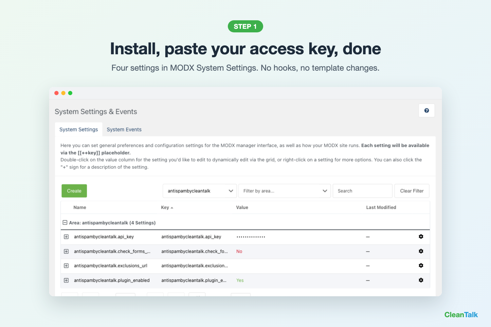
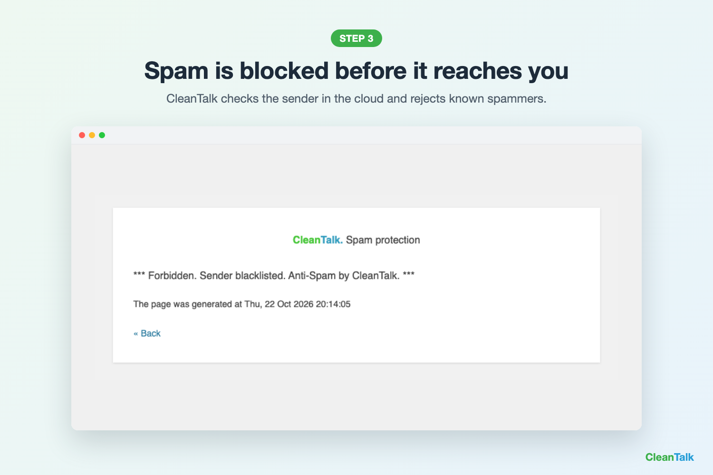

# Antispam by CleanTalk for MODX

Spam protection for MODX forms without CAPTCHA, reCAPTCHA or puzzles.
Checks contact, FormIt, sign-up and AJAX forms in the cloud and blocks spam bots. Used on 1,100,000+ websites.

> **Free months for your review.** Post a review about CleanTalk on a community platform (for example, community.modx.com), then send us the link from your [CleanTalk dashboard > Bonuses](https://cleantalk.org/my/bonuses). We add free months to your annual license.

## What it protects
- Any front-end form that sends POST data, including FormIt
- AJAX forms
- Optional: forms without an email field

## Requirements
- MODX 3.x or 2.x (tested on MODX 3.2.4, PHP 8.2)
- CleanTalk access key: [cleantalk.org/register](https://cleantalk.org/register?platform=modx&utm_source=modx&utm_medium=github), 7-day free trial, no card

## Install
1. Extras > Installer > Download Extras, search "CleanTalk", install
2. System Settings > namespace `antispambycleantalk` > `api_key`: paste your access key

| Setting | What it does |
|---|---|
| `antispambycleantalk.api_key` | Your access key |
| `antispambycleantalk.plugin_enabled` | Turns protection on or off |
| `antispambycleantalk.exclusions_url` | Pages to skip, comma separated |
| `antispambycleantalk.check_forms_without_email` | Also check forms with no email field |

## Free Anti-Spam & Security Licenses for Developers

We offer free Anti-Spam and Security licenses to developers who contribute to the development and maintenance of our plugins.

**How to qualify for free licenses:**
- Have at least one contribution to our plugins approved.
- Manage plugin, module, or extension releases and maintain their listings on relevant community platforms.

Interested? Contact us at [welcome@cleantalk.org](mailto:welcome@cleantalk.org) to claim your free licenses.

## Links
- [MODX Extras page](https://extras.modx.com/package/antispambycleantalk)
- [CleanTalk dashboard](https://cleantalk.org/my)
- [Support](https://cleantalk.org/my/support)

If this extra helps you, please star ⭐ the repository.
